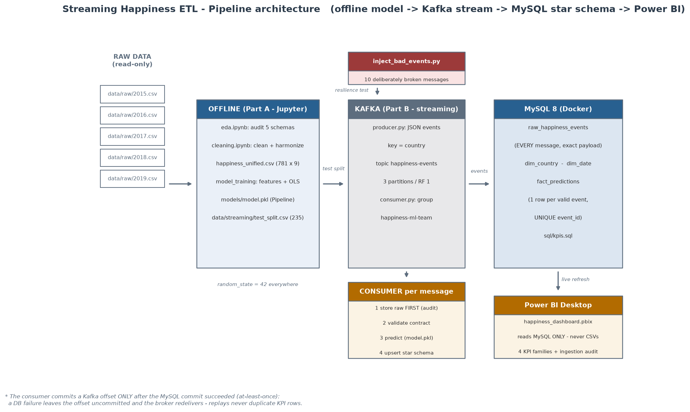
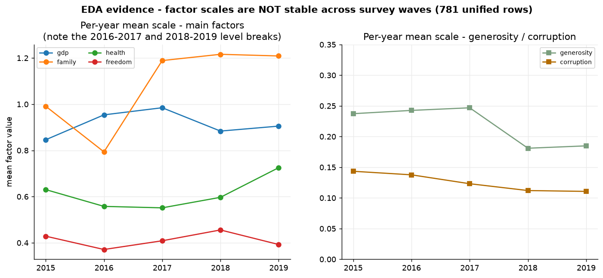
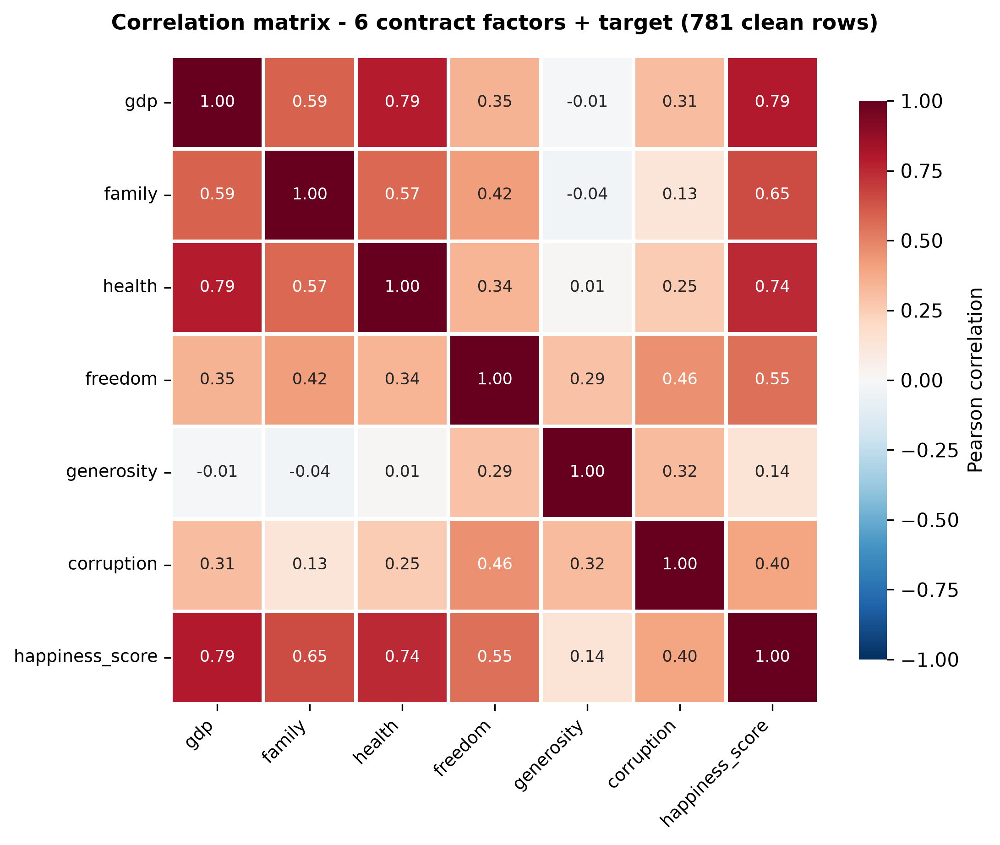
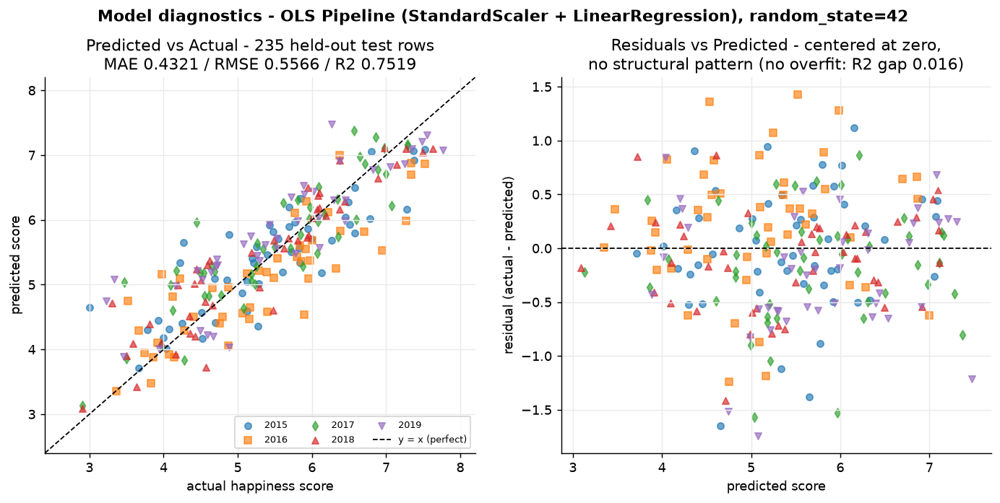
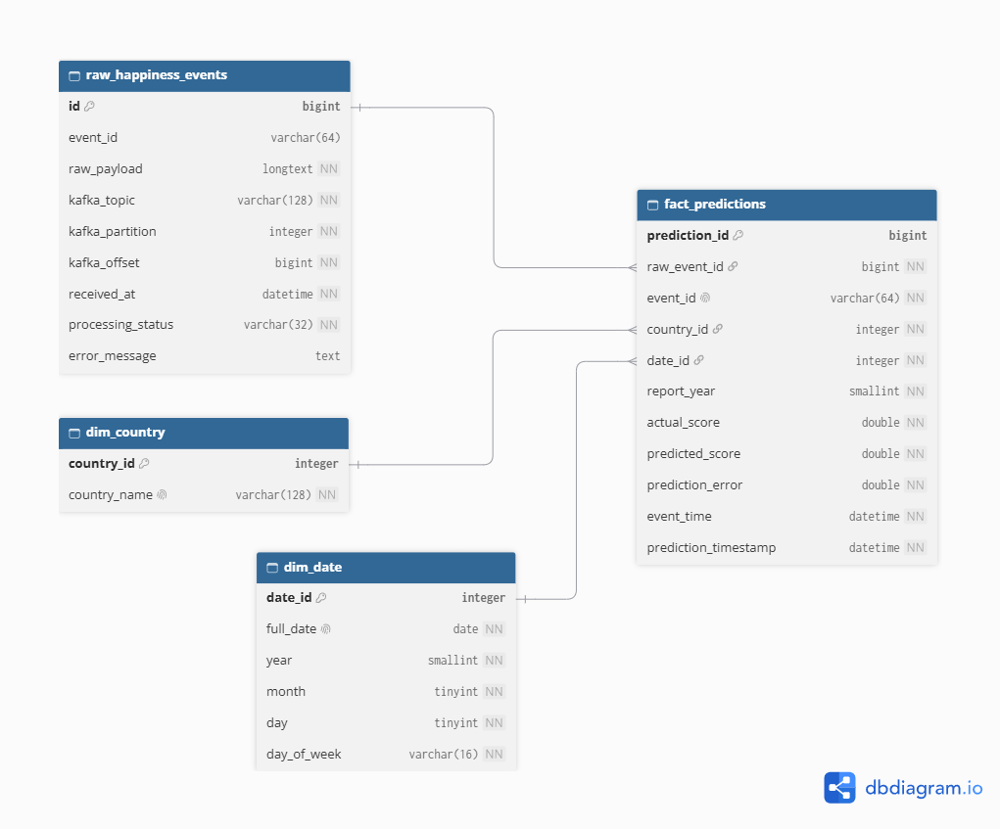
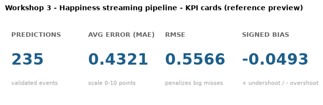
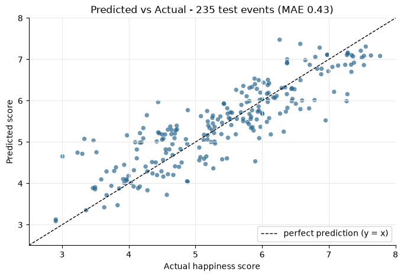
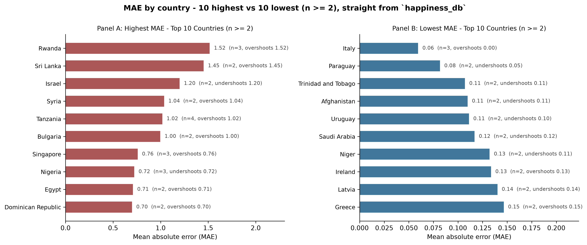
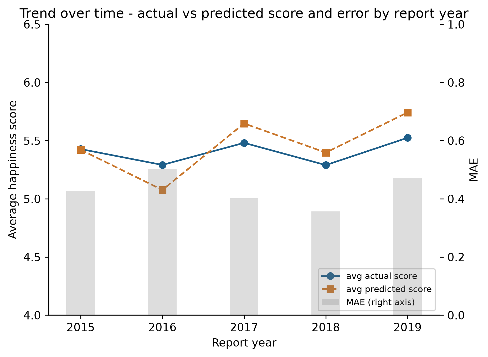

# 🚀 Streaming Happiness ETL — Apache Kafka + Machine Learning

End-to-end streaming ETL project (ETL course workshop): historical World
Happiness data (2015–2019) is cleaned and harmonized offline, a regression
model is trained on it, the held-out test set is **streamed through Apache
Kafka as JSON events**, a consumer validates every message in real time, runs
inference with the trained model, stores results in a **MySQL 8 star schema**,
and a **Power BI** dashboard reads the database to present the KPIs.

> **Goal discipline:** this project is graded on a clean, reproducible,
> reliable, integrated streaming pipeline — not on model accuracy. Every design
> choice below favors simple and robust over clever.

---

## Table of contents

1. [Project description & objectives](#1-project-description--objectives)
2. [Architecture & data flow](#2-architecture--data-flow)
3. [Data cleaning decisions](#3-data-cleaning-decisions)
4. [Feature engineering & modeling](#4-feature-engineering--modeling)
5. [Kafka streaming pipeline & event contract](#5-kafka-streaming-pipeline--event-contract)
6. [Database star schema](#6-database-star-schema)
7. [Dashboard & KPIs explanation](#7-dashboard--kpis-explanation)
8. [Step-by-step execution guide](#8-step-by-step-execution-guide)
9. [Repository layout](#9-repository-layout)
10. [Presentation guide](#10-presentation-guide)

---

<a id="1-project-description--objectives"></a>
## 1. 🎯 Project description & objectives

### What this project does

Three integrated parts over the World Happiness Report data (2015–2019):

* **Part A — Offline batch ETL + model.** Five raw CSVs with *different schemas*
  are audited, cleaned, harmonized into one unified dataset
  (`data/processed/happiness_unified.csv`), and used to train a multiple linear
  regression (OLS) that predicts the happiness score from six socioeconomic
  factors. The model is exported as a self-contained scikit-learn `Pipeline`
  (`models/model.pkl`).
* **Part B — Streaming.** The 235-row test split (data the model never saw) is
  published to the Kafka topic `happiness-events` as JSON events keyed by
  country. A consumer in group `happiness-ml-team` stores **every** message raw
  *before* validating, validates the event contract, scores valid events with
  the model, and writes the star schema in MySQL 8 — surviving broken messages
  without crashing.
* **Part C — Analytics.** Idempotent SQL KPI queries (`sql/kpis.sql`) and a
  Power BI dashboard connected to the database (never to CSVs).

### Objectives

| # | Objective | Evidence |
|---|-----------|----------|
| 1 | Unified, clean dataset from 5 heterogeneous CSVs | 782 raw rows → 781 clean rows, 164 countries, zero missing values |
| 2 | Leakage-free regression model with honest validation | test MAE **0.4321**, RMSE **0.5566**, R² **0.7519** vs train MAE 0.4225 (no overfitting) |
| 3 | Real-time inference pipeline that never loses or duplicates data | at-least-once commits, idempotent upserts, replay leaves KPIs unchanged |
| 4 | Resilience against garbage input | 10 deliberately broken message types stored + correctly flagged, 0 of them predicted |
| 5 | Decision-ready analytics | 4 KPI families served from MySQL, dashboarded in Power BI |

---

<a id="2-architecture--data-flow"></a>
## 2. 🏗 Architecture & data flow



*Fig. 1 — Pipeline architecture: read-only raw CSVs → offline cleaning + OLS
Pipeline → Kafka (`happiness-events`, key = country, 3 partitions) → consumer
(store-first / validate / predict / upsert) → MySQL 8 star schema → Power BI
Desktop reading the database. The fine print: Kafka offsets are committed only
after the MySQL commit succeeded (at-least-once), so a DB failure redelivers —
and replays never duplicate KPI rows.*

Data flows strictly forward: raw CSVs are read-only; downstream steps always
load the *processed* file, never the raw ones; the dashboard only queries MySQL.

---

<a id="3-data-cleaning-decisions"></a>
## 3. 🧹 Data cleaning decisions

All of this is implemented and verified in `notebooks/cleaning.ipynb` (every
step logs its row count) and audited first in `notebooks/eda.ipynb`.

### 3.1 What the raw data looks like

* **Row counts (header excluded):** 158 / 157 / 155 / 156 / 156 = **782 rows**.
* **No year column anywhere** — `year` is derived from the file name.
* **Every year has a different schema** (names like `Happiness.Score`,
  `GDP per capita`, `Social support`, `Trust..Government.Corruption.`...) and a
  **different column order** (e.g., Trust comes *before* Generosity in 2015–16,
  *after* it in 2017–19). Columns are therefore always selected **by name**,
  never by position.
* 2017 arrives with R-style dotted headers and 15-decimal floats; everything is
  cast explicitly (`country` → str, `year` → int64, the rest → float64).

### 3.2 Columns dropped (with justification)

| Dropped column(s) | Years | Why |
|---|---|---|
| `Happiness Rank` / `Happiness.Rank` / `Overall rank` | all | Direct target leak: rank is the score's ordering |
| `Standard Error` (2015), `Lower/Upper Confidence Interval` (2016), `Whisker.high/low` (2017) | 1 year each | Same reasoning: functions of the target's distribution; also absent from the streaming event |
| `Dystopia Residual` (2015–2017) | 3 years | Literally `score − sum of the six factors`: perfect leakage |
| `Region` (2015–2016) | 2 years | Not part of the event contract and missing in 2017–2019 |

### 3.3 Missing values — drop, do not impute

Exactly **one** cell of the 782 raw rows is missing (0.13 %): **United Arab
Emirates, 2018, `corruption` = `'N/A'`**. `corruption` is a subjective
perception index — a statistical imputation would fabricate a perception no
respondent reported, and the cell is 0.13 % of the data, so the whole row is
dropped. **782 → 781 rows.** Final dataset: **no missing values anywhere**
(the consumer also rejects any missing feature at inference time).

### 3.4 Zeros are kept — they are real

31 zero cells remain because the reports *publish* zeros (e.g., Greece scores
`generosity` 0.0 every year; Afghanistan `freedom` 0.0 in 2019; Central African
Republic `family` 0.0). These are **floor values of the underlying
distribution, not missing-value sentinels** — imputing or dropping them would
falsify the data. Every numeric column is verified to carry no negatives.

### 3.5 Country-name normalization (the Kafka key)

The same country appears under different names across years, so one explicit
mapping normalizes **6 variant names (12 cells)**:

| Variant | Canonical |
|---|---|
| `Hong Kong S.A.R., China` | `Hong Kong` |
| `Macedonia` | `North Macedonia` |
| `North Cyprus` | `Northern Cyprus` |
| `Somaliland region` | `Somaliland Region` |
| `Taiwan Province of China` | `Taiwan` |
| `Trinidad & Tobago` | `Trinidad and Tobago` |

Result: **164 canonical countries**, `(country, year)` unique everywhere.
Because `country` is the Kafka message key and `dim_country`'s natural key, a
misspelled name would split one country into two — text hygiene (whitespace,
case, `&`/`and`) is verified programmatically.

### 3.6 Scale shifts between survey waves

Factor scales are **not identical across years** (e.g., Denmark's `family`
jumps 1.16 → 1.55 between 2016 and 2017; `health` shifts 0.79 → 0.87 → 1.00
across 2017–2019). No per-year rescaling was applied: the linear model absorbs
wave-level level shifts in its intercept/slopes, and adding `year` as a feature
was measured to help only marginally (section 4.2). This is a
documented harmonization limitation, respected rather than hidden.



*Fig. 2 — EDA evidence: per-year mean of each factor across the five survey
waves. The `family` jump at 2016→2017 and the `health`/`freedom` breaks at
2018→2019 are the wave-level scale shifts the model must absorb without a
`year` feature.*

### 3.7 Row accounting (reproducible)

| Step | Rows |
|---|---|
| Load 5 raw files (year from file name) | 782 |
| Rename + select the 9 unified columns | 782 |
| Cast types | 782 |
| Normalize country names (12 cells) | 782 |
| Verify `(country, year)` uniqueness | 782 |
| Drop the 1 missing-value row (UAE 2018) | **781** |

---

<a id="4-feature-engineering--modeling"></a>
## 4. 📐 Feature engineering & modeling

Implemented in `notebooks/model_training.ipynb` (feature engineering + training
in one notebook, `random_state=42` everywhere).

### 4.1 The six contract features (frozen order)

```
FEATURES = ["gdp", "family", "health", "freedom", "generosity", "corruption"]
TARGET   = "happiness_score"     # NEVER a feature
```

Chosen because each one (a) travels inside the streaming event JSON, (b) is
numeric, and (c) does not reveal the answer by construction. Correlations with
the target: `gdp` 0.79, `health` 0.74, `family` 0.65, `freedom` 0.55,
`corruption` 0.40, `generosity` 0.14 — all real signal, nothing leaks it.



*Fig. 3 — The 7×7 Pearson matrix (6 factors + target): strong signal
(`gdp`/`health`/`family` vs score ≥ 0.65), weak correlations among factors
(no problematic multicollinearity for OLS), and the target appearing only as an
outcome column.*

### 4.2 Why `year` is NOT a feature (measured, not guessed)

Adding the report year as a 7th feature was compared on the **same split**:

| Model | MAE test | RMSE test | R² test |
|---|---|---|---|
| 6 features (default) | 0.4321 | 0.5566 | 0.7519 |
| 7 features (+ `year`) | 0.4201 | 0.5438 | 0.7632 |

The gain (~ −0.012 MAE, ≈ 2.8 %) mostly compensates the 2016→2017 /
2018→2019 scale breaks rather than adding information (`corr(year, score)` ≈
0.006). `year` **is** a required field of the event contract (§5.2) and the
consumer stores it on the fact as `report_year` — but it is temporal
survey-wave metadata, not one of the six socioeconomic factors the model is
allowed to score with. **Decision: keep the 6 contract features.**

### 4.3 Model: OLS only, by design

* `happiness_score` is a continuous 0–10 index → multiple **linear regression**
  (ordinary least squares) is the correct simple baseline; classifier or count
  models do not apply.
* Preprocessing lives **inside** the same sklearn `Pipeline`:
  `Pipeline([("scaler", StandardScaler()), ("model", LinearRegression())])` —
  inference-time rows are scaled with statistics learned on the training split
  only (no leakage, no separate scaler file to drift out of sync).

**Standardized effect ranking** (score change per +1 SD of the feature):
`gdp` 0.43 > `health` 0.27 > `freedom` 0.25 > `family` 0.21 >
`corruption` 0.10 > `generosity` 0.07.

### 4.4 Validation — train vs test (overfit check)

One deterministic 70/30 split: **546 train / 235 test** rows.

| Split | n | MAE | RMSE | R² |
|---|---|---|---|---|
| Train | 546 | 0.4225 | 0.5448 | 0.7675 |
| Test  | 235 | **0.4321** | **0.5566** | 0.7519 |

The R² gap is 0.0156 — a linear model on 6 interpretable factors with no
tuning; there is no overfitting to fix and nothing exotic to justify.



*Fig. 4 — Test-split diagnostics (235 held-out rows): predicted vs actual
hugging the y = x diagonal, and residuals centered at zero with no structural
pattern — the model errs randomly, not systematically — except at the extremes,
which is exactly what the per-country KPI surfaces (§7).*

### 4.5 Artifacts

* `models/model.pkl` — the complete fitted Pipeline (scaler + coefficients),
  1.6 KB. Re-verified after export: a **fresh Python interpreter** reloads it
  and reproduces predictions to the last digit.
* `data/streaming/test_split.csv` — the 235 test rows with the score as the
  actual outcome. The producer streams **only** these rows, so every KPI in the
  database measures data the model did not train on.

---

<a id="5-kafka-streaming-pipeline--event-contract"></a>
## 5. 📡 Kafka streaming pipeline & event contract

### 5.1 Fixed contract

| Item | Value |
|---|---|
| Topic | `happiness-events` (3 partitions, replication factor 1, created programmatically by the producer) |
| Message key | `country` (all events of a country land on the same partition, ordered per country) |
| Consumer group | `happiness-ml-team` |
| Serialization | JSON / UTF-8 |
| Model artifact | `models/model.pkl` (full scikit-learn Pipeline) |

### 5.2 Event schema (exact JSON)

```json
{
  "event_id": "E001",
  "country": "Colombia",
  "year": 2019,
  "gdp": 1.2,
  "family": 0.8,
  "health": 0.9,
  "freedom": 0.6,
  "generosity": 0.3,
  "corruption": 0.1,
  "actual_happiness_score": 6.2,
  "event_time": "2026-10-30T15:30:00"
}
```

Validation rules enforced by the consumer:

* `event_id` — non-empty string, unique per fact row.
* `country` — non-empty string; **must equal the Kafka message key**.
* `year` — integer. Feature numbers — numeric (bool rejected), never NaN/inf,
  never negative.
* `actual_happiness_score` — numeric; used **only** for evaluation, never as a
  feature.
* `event_time` — valid ISO-8601 timestamp.

### 5.3 Consumer design: store first, validate later, never crash

Message pipeline in strict order:

1. **Store raw.** The exact UTF-8 string received is written to
   `raw_happiness_events` with its Kafka coordinates `as-is` (LONGTEXT, not a
   JSON column — malformed JSON must still be storable), status `PENDING`.
2. **Validate.** Unparseable JSON / missing fields / bad types →
   `INVALID_SCHEMA`; present but semantically wrong (NaN/inf, negatives,
   non-ISO time, wrong types) → `INVALID_VALUES`. Each rejection is recorded
   with a specific error message; prediction is skipped.
3. **Predict.** Valid events are scored with `model.pkl` in the **same frozen
   feature order as training** (the consumer hard-guard-checks
   `feature_names_in_` at startup). Model failure → `PREDICTION_ERROR`.
4. **Store analytically.** `dim_country` / `dim_date` upserts +
   `fact_predictions` insert + raw status flip to `VALID`, all in **one atomic
   transaction**.

**At-least-once offsets:** `enable.auto.commit=false`. A Kafka offset is
committed (`consumer.commit(..., asynchronous=False)`, per message) **only
after** the MySQL commit actually succeeded. A DB failure leaves the offset
uncommitted → the broker redelivers; a hard kill resumes exactly from the last
committed offset.

**Idempotency:** raw rows are deduplicated by `(topic, partition, offset)`
(unique constraint — replays reuse the same raw row), and
`fact_predictions` is unique per `event_id` with `INSERT ...
ON DUPLICATE KEY UPDATE`, so re-running the producer/consumer never duplicates
predictions or inflates KPIs (verified by a full replay test).

### 5.4 Resilience test — deliberately broken messages

`kafka/inject_bad_events.py` publishes a fixed catalog of **10** broken
messages: malformed JSON; missing `freedom`; missing `event_id`; `gdp` as
text; negative `family`; NaN `corruption`; non-ISO `event_time`; `year` as
string; JSON `null` field; and a fully valid JSON published **without a Kafka
key** (violating key = country). Expected outcome — and live-verified one:

| Status | Count |
|---|---|
| `VALID` | 235 |
| `INVALID_SCHEMA` | 4 |
| `INVALID_VALUES` | 6 |

Invalid rows stay in `raw_happiness_events` (audit trail with the exact payload
and error message) and **none** of them ever reach `fact_predictions`, while
the consumer keeps running throughout.

### 5.5 Scripts and configuration

* `kafka/producer.py` — streams the test split; flags `--delay SECONDS`
  (default from `.env`'s `PRODUCER_DELAY_SECONDS`) and `--limit N`.
* `kafka/consumer.py` — flags `--max-messages N` and `--timeout SECONDS`
  (idle-exit for unattended runs; the idle timer resets on activity).
* `kafka/inject_bad_events.py` — flag `--repeat N` to publish the bad catalog
  N times.
* All settings come from `.env` (see `.env.example`): Kafka bootstrap/topic/
  group, MySQL credentials, `MODEL_PATH`, `STREAMING_DATA_PATH`.

---

<a id="6-database-star-schema"></a>
## 6. ⭐ Database star schema

MySQL 8 (official `mysql:8.0` image via Docker Compose), InnoDB + `utf8mb4`.
All DDL is `CREATE TABLE IF NOT EXISTS` — the schema file is idempotent.



*Fig. 5 — Star schema (exported from dbdiagram.io): the raw landing table keeps
EVERY Kafka message with its processing status; `fact_predictions` references it
(`raw_event_id`) plus both dimensions (`country_id`, `date_id`); `event_id` is
UNIQUE on the fact (dedup per event) but only indexed on the raw table, where
duplicate broker ids are legitimate. Full DDL: `sql/create_tables.sql`.*

Key design decisions:

* **Raw layer tolerates what the fact layer forbids.** Invalid events may lack
  `event_id` and re-runs resend ids, so `raw_happiness_events.event_id` is
  nullable and only indexed (never UNIQUE); broker replays map to the same row
  via the `(kafka_topic, kafka_partition, kafka_offset)` unique key.
* **`fact_predictions` is UNIQUE per `event_id`** and the consumer upserts
  (`ON DUPLICATE KEY UPDATE`) — the analytical layer is idempotent under
  replays. `raw_event_id` links every prediction to the exact raw message it
  came from (full lineage).
* `dim_date.date_id` is the emission date as integer `YYYYMMDD` (derived
  straight from `event_time`, stable across re-runs); the *survey* year lives
  on the fact as `report_year` because trends are read per survey wave.
* `prediction_error = actual_score − predicted_score` (signed: + model
  undershoots, − model overshoots).

---

<a id="7-dashboard--kpis-explanation"></a>
## 7. 📈 Dashboard & KPIs explanation

The **official interactive deliverable** is the Power BI Desktop report
`dashboards/happiness_dashboard.pbix`, which connects **directly to MySQL**
(`localhost:3306`, db `happiness_db`, user `happiness_user`) — never to CSVs.
The 4 reference views below are static renders of the same aggregations as
`sql/kpis.sql`, served from `happiness_db` exactly as Power BI reads them;
the human stores the .pbix in `dashboards/` and accompanies/updates them with
the real Power BI captures. Full setup, star-model relationships and DAX
measures are in [`dashboards/README.md`](dashboards/README.md).

### The 4 KPI families (`sql/kpis.sql`)

| # | KPI | Meaning | Live value (235 streamed test events) |
|---|-----|---------|----------------------------------------|
| 1 | **Average prediction error** | Global MAE **0.4321**, RMSE **0.5566**, signed bias **−0.049** (slight overshoot tendency), plus the same per survey year (MAE range 0.36–0.50) | The dashboard MAE **exactly equals** the offline test MAE — same 235 rows, streamed through Kafka end to end |
| 2 | **Predictions by country** | Country ranking with count, avg predicted vs avg actual score and MAE: model hits most with **Italy** (MAE 0.06), fails most with **Rwanda** (MAE 1.52, systematic overshoot on very low scores) | 140 countries streamed |
| 3 | **Predicted vs actual** | Event-level scatter detail: real score, predicted score, signed error, absolute error and % deviation, ready for a scatter diagonal (y = x) | 235 rows, error = actual − predicted recomputed to < 1e-12 |
| 4 | **Trend over time** | Actual vs predicted score and mean error by `report_year` (2015–2019 waves) and by emission instant of the stream | Per-wave breakdown exposes the 2016/2017 factor-scale break |
| + | **Ingestion quality (extra)** | `raw_happiness_events` status distribution: `VALID` 95.9 % / `INVALID_SCHEMA` 1.6 % / `INVALID_VALUES` 2.4 % | The resilience proof, queryable |

### The 4 KPI reference views (served from `happiness_db`)









*Figs. 6–9 — The 4 dashboard views, rendered from `fact_predictions` in
`happiness_db` (the same 235-row analytical set Power BI reads). The Power BI
report (`dashboards/happiness_dashboard.pbix`) implements each one with the DAX
measures from `dashboards/README.md` §3.*

### Analytical findings

* The model is **unbiased at the aggregate level** (mean error −0.05).
* Failures concentrate on **very low-scoring countries with extreme inputs**
  (Rwanda, Syria, Sri Lanka, Tanzania): the linear model overshoots because
  their factor profiles sit at the edge of the training distribution.
* Per-survey-wave MAE is stable (0.36–0.50); no wave is catastrophically off,
  which supports keeping `year` out of the feature set.
* The streaming layer reproduced the offline evaluation **bit-exact**: the
  consumer's predictions match `model.pkl`'s output to < 1e-12 for all 235
  events, and the dashboard's MAE equals the notebook's test MAE.

---

<a id="8-step-by-step-execution-guide"></a>
## 8. 🛠 Step-by-step execution guide

Everything runs locally with Docker + Python 3.12. From a fresh clone:

### 0. Prerequisites

* Docker Desktop (Kafka + MySQL run in containers)
* Python 3.12
* (only for the dashboard) Power BI Desktop + [MySQL Connector/NET](https://dev.mysql.com/downloads/connector/net/) — see `dashboards/README.md`

### 1. Infrastructure

```powershell
git clone <your-repo-url> Workshop-3
cd Workshop-3

copy .env.example .env        # Windows (use `cp` on Linux/macOS)
# adjust .env if your ports/credentials differ

docker compose up -d
docker compose ps             # wait until kafka + mysql are healthy
```

(Optional UI: `docker compose --profile tools up -d` exposes a Kafka UI on
port 8080.)

### 2. Python environment

```powershell
python -m venv .venv
.\.venv\Scripts\activate                # Windows
pip install -r requirements.txt
```

### 3. Offline pipeline (Part A — optional: the artifacts are already in the repo)

```powershell
jupyter lab
# run IN ORDER, top to bottom:
#   notebooks/eda.ipynb          -> raw audit
#   notebooks/cleaning.ipynb     -> data/processed/happiness_unified.csv (781 x 9)
#   notebooks/model_training.ipynb -> models/model.pkl + data/streaming/test_split.csv (235)
```

### 4. Database schema

```powershell
cmd /c "docker compose exec -T mysql mysql -uhappiness_user -pchange_me happiness_db < sql/create_tables.sql"
```

### 5. Stream the test split through Kafka

```powershell
# creates the topic on first run + streams the 235 events
# (--delay 0 = fast unattended run; drop it to watch the stream in real time)
.\.venv\Scripts\python.exe kafka/producer.py --delay 0
```

### 6. (Resilience test) inject broken messages

```powershell
.\.venv\Scripts\python.exe kafka/inject_bad_events.py          # 10 broken messages
```

### 7. Consume, validate and predict

```powershell
.\.venv\Scripts\python.exe kafka/consumer.py --timeout 10
# expected session summary: consumed=245, VALID=235, INVALID_SCHEMA=4, INVALID_VALUES=6
```

(Without flags the consumer runs until Ctrl+C; it survives any bad message and
resumes from the last committed offset if killed.)

### 8. KPI queries

```powershell
cmd /c "docker compose exec -T mysql mysql -uhappiness_user -pchange_me happiness_db < sql/kpis.sql"
```

Expected headline row: `n_predictions=235, mae_global=0.4321, rmse_global=0.5566`.

### 9. Dashboard

Open `dashboards/README.md` and follow its step-by-step Power BI connection
(`localhost:3306` → `happiness_db`) and visual-by-visual build guide.

### 10. Reproducibility guarantees

* Re-running the producer/consumer never changes the KPIs (raw rows dedup by
  Kafka coordinates; facts upsert by `event_id`).
* Killing the consumer mid-run and restarting resumes from the last committed
  offset (at-least-once), without duplicating fact rows.
* The notebooks are idempotent and `random_state=42`-pinned; `model.pkl`
  reloads bit-exact in a fresh interpreter.

---

<a id="9-repository-layout"></a>
## 9. 🗂 Repository layout

```
Workshop-3/
├── data/
│   ├── raw/                     # original CSVs 2015–2019 (READ-ONLY)
│   ├── processed/               # happiness_unified.csv (clean dataset)
│   └── streaming/               # test_split.csv (235 rows the producer streams)
├── notebooks/
│   ├── eda.ipynb                # raw audit: schemas, quality, distributions
│   ├── cleaning.ipynb           # unified dataset + row accounting
│   └── model_training.ipynb     # features, OLS Pipeline, metrics, export
├── kafka/
│   ├── producer.py              # test-split -> happiness-events (key=country)
│   ├── consumer.py              # store-first / validate / predict / upsert
│   └── inject_bad_events.py     # 10 broken messages for resilience tests
├── models/
│   └── model.pkl                # fitted Pipeline (StandardScaler + OLS)
├── sql/
│   ├── create_tables.sql        # star schema (idempotent, utf8mb4)
│   └── kpis.sql                 # the 4 KPI families + ingestion audit
├── dashboards/
│   ├── README.md                # Power BI guide + DAX + presentation plan
│   ├── happiness_dashboard.pbix # Power BI report (saved from Power BI Desktop)
│   ├── diagrams/                # README figures (architecture, star schema, EDA/model evidence)
│   └── screenshots/             # 4 KPI reference views (+ your Power BI captures)
├── docker-compose.yml           # Kafka (KRaft) + MySQL 8 (+ optional Kafka UI)
├── requirements.txt             # pinned dependencies
├── .env.example                 # configuration template (never commit .env)
└── README.md                    # this file
```

<a id="10-presentation-guide"></a>
## 10. 🎤 Presentation guide

The oral-defense outline (architecture in one picture, why OLS is the right
simple baseline, the live resilience demo against broken messages, and how the
KPI numbers were verified end to end) is in
[`dashboards/README.md` § 5](dashboards/README.md#5-oral-presentation-quick-guide-30-of-the-grade).
